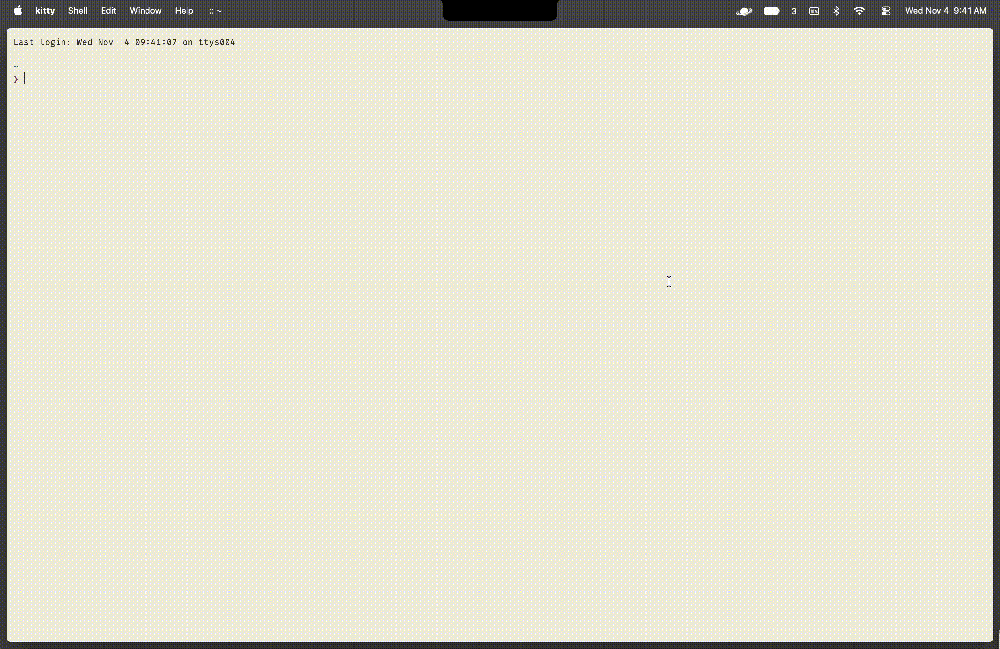

# Terminal Eject

A tiny ratatui program that animates your terminal shell closing with the titanfall 2 ejection messages.

# Install
```bash
git clone https://github.com/whatonlylue/term-eject.git
cd term-eject
cargo build --release
```
Then inside of your rc file of choice, append this at the end
```zsh
on_exit() {
    # For most this will build to term_eject/release/term_eject
    $HOME/path/to/term-eject
}
trap on_exit EXIT
```
# Quirks
For those of you that enter commands to close or quit windows, it will not render the exit script as those call the os to close the process vs your shell calling it. A work around for this is remapping your close window or quit command to enter exit in the terminal. For example for `kitty` we have in `kitty.conf`:
```toml
# All your other stuff
map cmd+w send_text all exit\r
```

> "Could this flight be any slower?"
> - *Droz*
